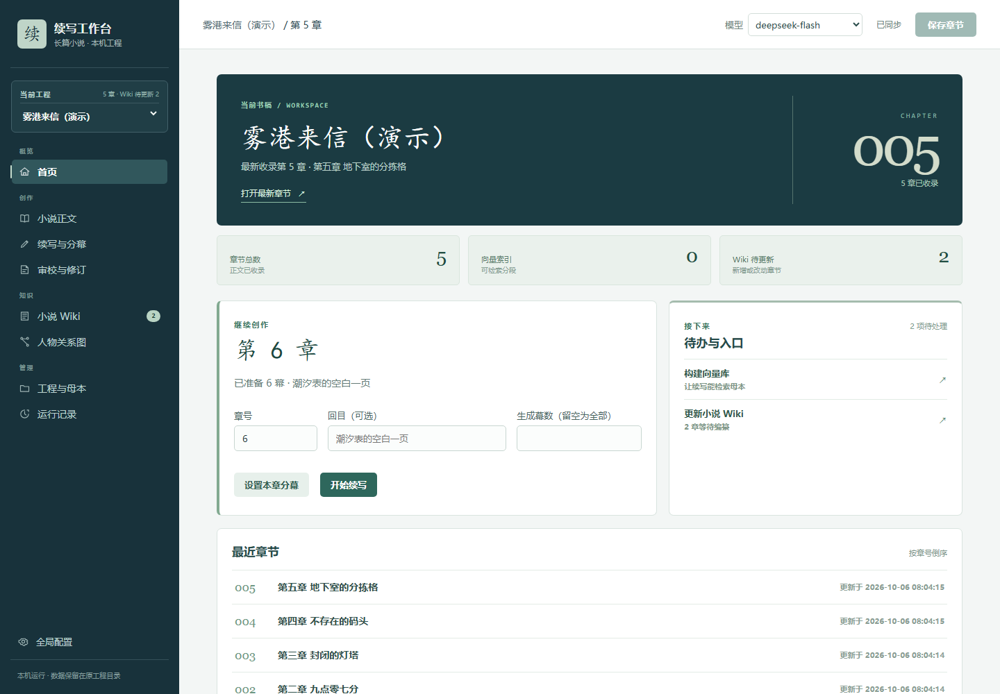
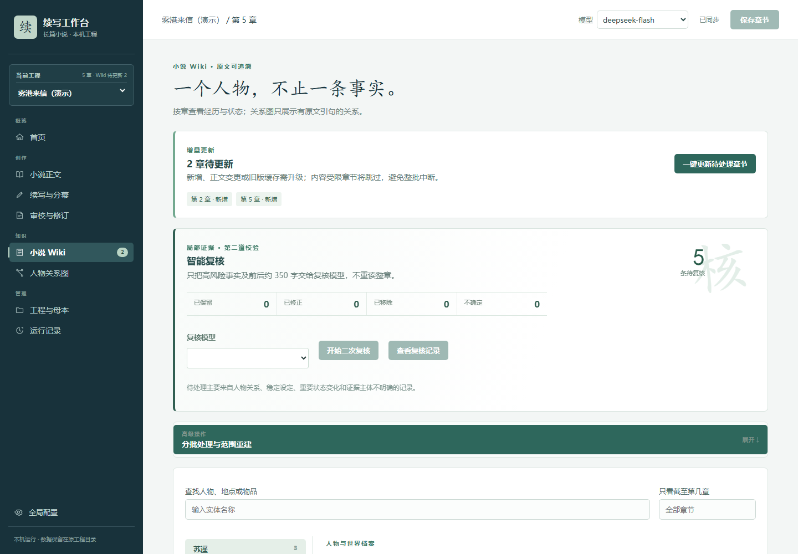
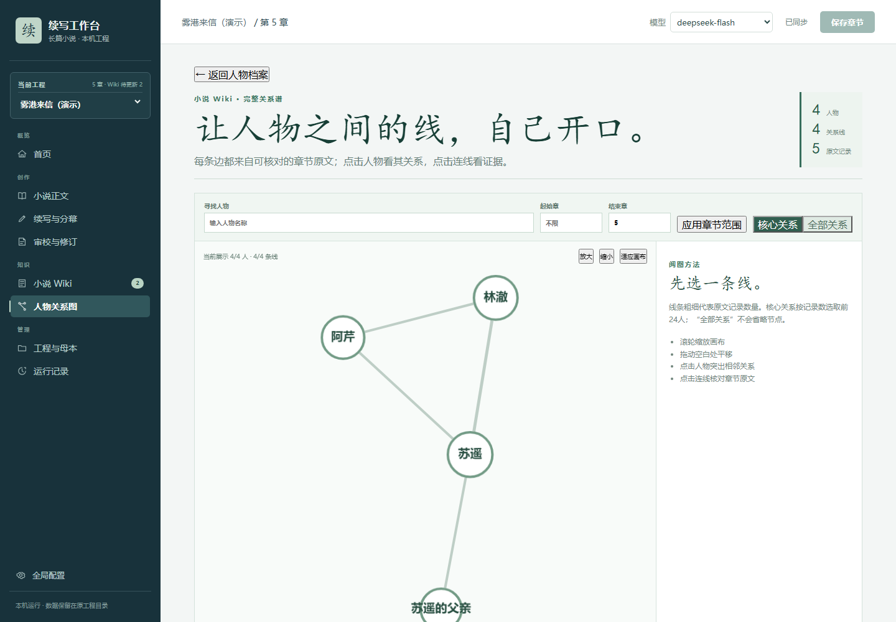
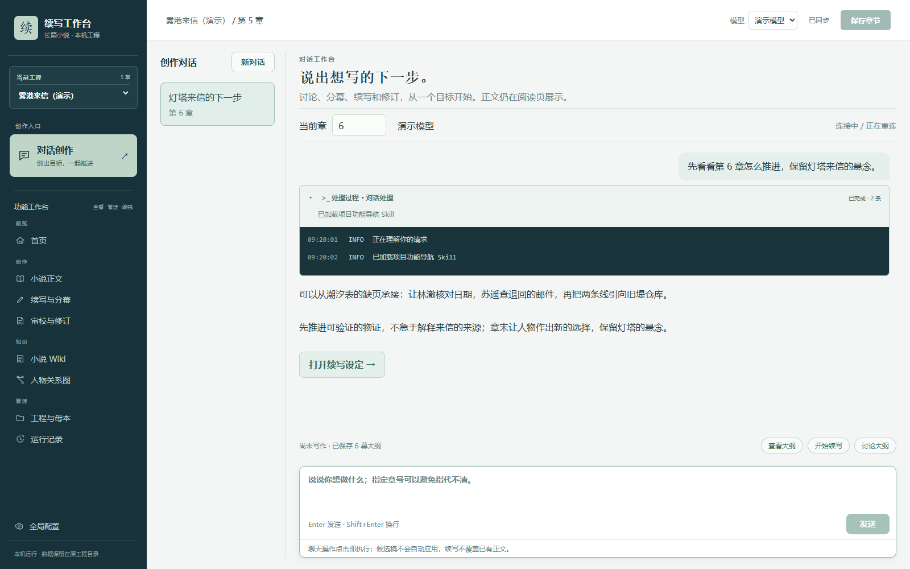

# 小说续写工作台

> 面向长篇小说的本地 AI 写作工作台：记住前文、管理设定、规划后续，让每次修改都可核对、可回退。

小说续写工作台不是一个只有“生成下一段”的聊天框。它围绕长篇创作提供正文管理、分幕规划、小说 Wiki、历史查证、人物关系、故事审校和可比较修订；一本书对应一个本机工程目录，正文、设定和运行记录默认留在你的电脑上。



## 为什么使用它

- **长篇记忆有依据**：从原文整理 Wiki，人物状态和关系都能回到章节引文。
- **先规划，再续写**：分幕规划会按需查阅历史正文，信息不足时保留疑问而不是编造答案。
- **修改不覆盖原稿**：候选稿可以逐段比较、编辑和验收，确认后才应用到正文。
- **本地优先**：小说工程、密钥和日志保存在本机；支持云端模型，也支持 Ollama。
- **完整创作工作流**：从母本导入、续写、审校、润色到插图和 Word 导出集中在一个界面。
- **对话创作入口**：自然语言发起查看、分幕、续写、故事审校和修订，也可询问项目功能并跳转到对应页面。会话与实时输出保存在本机，支持刷新恢复、重命名和删除，正文仍在阅读页展示。

| 正文与插图 | 有原文证据的 Wiki | 人物关系图 |
| --- | --- | --- |
|  |  |  |

### 对话创作

说出目标即可讨论情节、规划分幕、续写、审校、修订或生成插图。助手会按需查阅正文、摘要、Wiki 和当前候选稿；处理过程折叠在对话中，生成结果以可操作卡片展示，候选内容由用户确认后才保存。

会话支持刷新恢复、切换、重命名和删除。同一章的分幕、正文候选和审校结果以版本对象保存，继续修改时默认承接当前会话里的最新候选，不会悄悄退回旧稿。

对话调度使用 [Deep Agents](https://github.com/langchain-ai/deepagents) 的工具调用循环，但只开放作品查阅和操作提案，不开放主机命令或直接写文件。OpenAI 兼容、DeepSeek 及 Ollama 等配置都会实际尝试调用；模型不支持工具调用时，界面会显示服务返回的具体原因。

完整输入、模型返回、工具请求和耗时保存在工程 `runs/plan_logs/deepagents_*.jsonl`。聊天回复可以停止，规划、修订和审校任务支持安全取消与检查点恢复。



## 快速体验

需要预先安装 Python 3.11+ 和 Node.js 20+。启动器会自动创建虚拟环境、安装缺失依赖、构建前端、检查端口并打开浏览器。

### Windows

克隆或下载项目后双击 `start.bat`。也可以在 PowerShell 中运行：

```powershell
.\start.ps1
```

仅检查环境而不安装或启动：`.\start.ps1 -Check`。

### macOS

首次使用先在终端赋予执行权限，之后可以双击 `start.command`：

```bash
chmod +x start.command start.sh
./start.command
```

也可以始终通过 `bash start.sh` 启动；仅检查环境可运行 `bash start.sh --check`。

### 手动启动

如需完全手动管理环境，在 PowerShell 中运行：

```powershell
git clone https://github.com/hwg119/novel-continuation.git
cd novel-continuation
python -m venv .venv
.\.venv\Scripts\Activate.ps1
pip install -r requirements.txt
npm install --prefix frontend
npm run build --prefix frontend
python web_main.py
```

打开 <http://127.0.0.1:8765>。想先浏览而不调用模型，可在“工程与母本 → 导入已有工程”中选择 `examples/demo-project`；原创演示小说《雾港来信》已经包含 5 章正文、下一章规划、Wiki 事实、人物关系和章节插图。

> 调用续写、规划、审校、Wiki 自动编纂和插图生成需要配置模型。浏览、编辑、全文搜索和查看演示数据不需要模型。

## 开发与手动维护

服务仅绑定 `127.0.0.1`。修改 Python 后重启 `web_main.py`；修改前端后重新运行 `npm run build --prefix frontend` 并刷新浏览器。开发前端时可运行 `npm run dev --prefix frontend`，Vite 会把 `/api` 请求转发到 Python 服务。

已有工程可以直接导入，不需要转换工程文件。

## Web 页面与流程

- **对话创作**：以自然语言讨论并发起创作任务，查看过程与结果，或跳转到对应功能页；与原有功能工作台并行使用。
- **首页**：汇总工程状态、最近章节、Wiki 待办和运行记录，并提供下一章续写入口。
- **小说正文**：按章节浏览、阅读和编辑正文，查看插图与摘要，搜索全书内容，生成分级英语学习版，比较修订稿并导出 Word。
- **续写与分幕**：维护全书规则、当前章规划和分幕大纲；支持模型提取、按问题修改以及续写生成。
- **审校与修订**：整体评估故事连续性和重大主线逻辑，提供可选情节增强，并生成可比较、可编辑、可回看的修订稿。
- **小说 Wiki**：从原文增量整理人物、事物、经历、状态和关系证据，为续写与审校提供可追溯参考。
- **人物关系图**：以人物和原文关系记录构建交互图谱，可按人物与章节范围查看关系变化。
- **工程与母本**：新建或导入工程、导入母本、管理章节范围和向量库。
- **运行记录**：按时间查看后台任务、生成过程、模型回复和错误信息；底部控制台同步显示当前任务进度。
- **开发者地图（默认关闭）**：只读浏览分幕、续写、审校与修订的核心数据流。仅当本机 `config.json` 设置 `"developer_map_enabled": true` 并重启服务后才注册接口和显示导航。点击节点查看上下游、输入材料的来源与组成、代码入口及 Skill / 提示词组装源码；源码附带行号和文件指纹。运行回放读取当前工程 `runs/plan_logs`，按事件查看实际输入、模型返回、工具和验收记录，不触发模型调用。质量回归页则只使用固定的合成审校用例：明确点击短/长上下文评测才会调用选定模型，产物独立保存在 `workspace/agent_trials`，可对比模型、Skill 版本、输入指纹、耗时及初筛结果，绝不读取或发送小说章节。地图是人工维护的设计索引，不是动态调用图；导入、Wiki、学习版和插图尚未展开。日志详情须主动展开，已配置密钥及常见凭证会隐藏，但小说和个人内容仍需在分享前人工检查。
- **全局配置**：管理并排序大模型配置，选择默认续写模型和当前向量模型，以及维护代理、工作目录等跨工程设置。

各页面有独立 URL，章节相关地址包含工程 ID 和章号；刷新或使用浏览器前进、后退不会默认跳回首页。

规划、续写、审校和修订分别加载项目内的专业 Skill。LangGraph 保存生成、检查和验收阶段，失败或中断后可从有效检查点继续；运行记录保留模型输入、返回和核验结果。

故事审校区分必须处理的主线问题与可选情节增强。修订默认局部修改，重大调整可切换整章重写；候选稿始终需要比较和确认，不会自动覆盖正文。

分幕硬校验只检查结构是否可用，时间、视角、连续性和情节推进交给独立模型复核并作为编辑提醒。按问题修改分幕会核对实际变化，未落实时进行有限补修，候选规划确认保存后才生效。

## 插图与 Word 导出

每章可以根据正文和章节规划生成独立的 SVG 插图，并在页面中预览或重新生成。插图会随当前章一起导出到 Word；没有插图时仅导出标题和正文。Word 使用适合中文阅读的排版，并包含章号和页码。

插图生成需要可用的大模型配置，Word 导出本身不会调用模型。

插图采用自由 SVG 意象图，由模型依据本章设计原创构图，不依赖素材库，支持路径、曲线、渐变和空间层次。保存前经过静态校验与 resvg 渲染，失败保留当前插图，最多生成两次。正文、插图预览与 Word 使用相同渲染器，自由绘制过程保留完整日志。

resvg 依赖随 `npm install --prefix frontend` 安装；后端渲染时需要 Node.js 在 PATH 中，无需新增常驻服务。依赖缺失会在调用模型前提示安装，插图预览及带插图的 Word 导出也需要该依赖。

## 工程数据与持久化

```text
workspace/
  projects.json                    工程索引
  <小说工程>/
    project.json                   本书设定与分章规划
    chapters/chapter_N.txt         母本与续写章节
    vectorstore/                   FAISS 向量索引及 SQLite 元数据
    wiki/chapters/chapter_N.json   按章提取的 Wiki 事实与正文哈希
    learning_editions/             与正文隔离的分级英语学习版
    illustrations/chapter_N.svg    已生成的本章插图（可选）
    exports/chapter_N.docx         Word 导出文件
    runs/web_jobs/                 Web 后台任务状态和日志
    runs/revisions/                章节旧稿快照
```

`config.json` 保存全局模型等配置，包含密钥；`workspace/` 保存用户小说。这两者已加入 `.gitignore`。章节保存会检查文件版本，避免覆盖另一浏览器窗口中的修改；实际保存时会留下旧稿快照。耗时任务在后台运行，服务重启后未完成的任务标记为“已中断”。

## 可选的本地模型

- **Ollama 大模型**：在“全局配置 → 大模型配置”选择 `Ollama`，填写 Base URL（例如 `http://localhost:11434/v1`）和模型名。续写调用 Ollama 原生 `/api/chat`。
- **本地 BGE-M3 Embedding**：运行 `python tools/embedding/dl_bge_m3.py` 下载模型，再运行 `python tools/embedding/embedding_server.py`。向量配置可指向默认的 `http://127.0.0.1:11435`。没有模型时可用“离线哈希”验证流程，但检索质量较低。

## 验证

### 可选模型追踪（Phoenix）

默认关闭，不影响原有 `requirements.txt`。只想使用小说工作台，无需安装任何追踪依赖。

Phoenix 查看服务与小说程序分开安装：

```powershell
python -m venv .venv-phoenix
.\.venv-phoenix\Scripts\python.exe -m pip install -r tools/observability/requirements-phoenix.txt
.\tools\observability\start-phoenix.ps1
```

服务页面为 `http://127.0.0.1:6006`，数据保存在 `workspace/phoenix`，启动脚本关闭平台遥测，HTTP 页面仅监听本机。Phoenix 另有默认的 gRPC 接收端口 4317（此版本监听所有地址）；本项目仅使用 HTTP 上报，不要将这两个端口开放到公网。

在小说项目原有虚拟环境中，仅安装采集端可选依赖，然后在启动工作台的同一终端启用：

```powershell
.\.venv\Scripts\python.exe -m pip install -r tools/observability/requirements-tracing.txt
$env:NOVEL_TRACE_ENABLED = '1'
$env:NOVEL_TRACE_ENDPOINT = 'http://127.0.0.1:6006/v1/traces'
.\.venv\Scripts\python.exe web_main.py
```

关闭方式：将 `NOVEL_TRACE_ENABLED` 设为 `0` 并重启工作台。依赖缺失时会警告并降级；上报在后台执行，失败不阻断生成，原有 JSONL 日志保留。

当前追踪统一模型调用及分幕生成/修订，记录提示词、原始输出、调用参数、异常、工作流阶段和审计事件。启用后小说文本会发送到配置的追踪地址，请不要未经确认配置外部服务；密钥字段及模型配置中的密钥值会脱敏。每条输入/输出默认最多记录 200000 字符，超出时标注截断，可通过 `NOVEL_TRACE_MAX_CHARS` 调整；`NOVEL_TRACE_PROJECT` 可指定 Phoenix 中的项目名。

### 常规验证

```powershell
python -m pytest -q tests
npm run build --prefix frontend
npm run test:diff --prefix frontend
npm run test:routes --prefix frontend
```

## 许可证

本项目采用 [GNU Affero General Public License v3.0](LICENSE)。第三方许可与归属信息见 [NOTICE](NOTICE)。

用户自行导入或创作的小说文本不会仅因使用本软件而自动适用 AGPL；模型供应商条款和所在地法律仍需用户自行确认。
